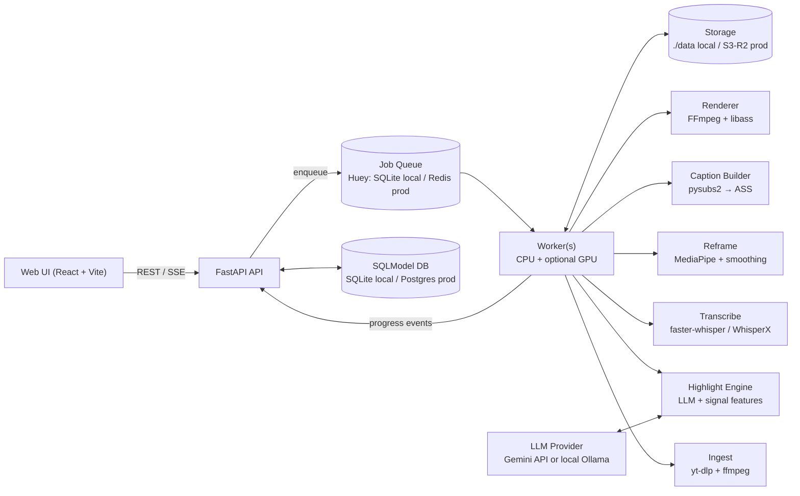
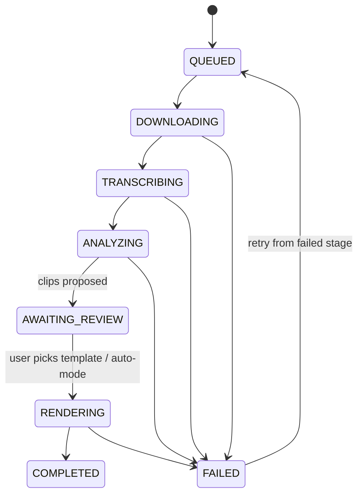
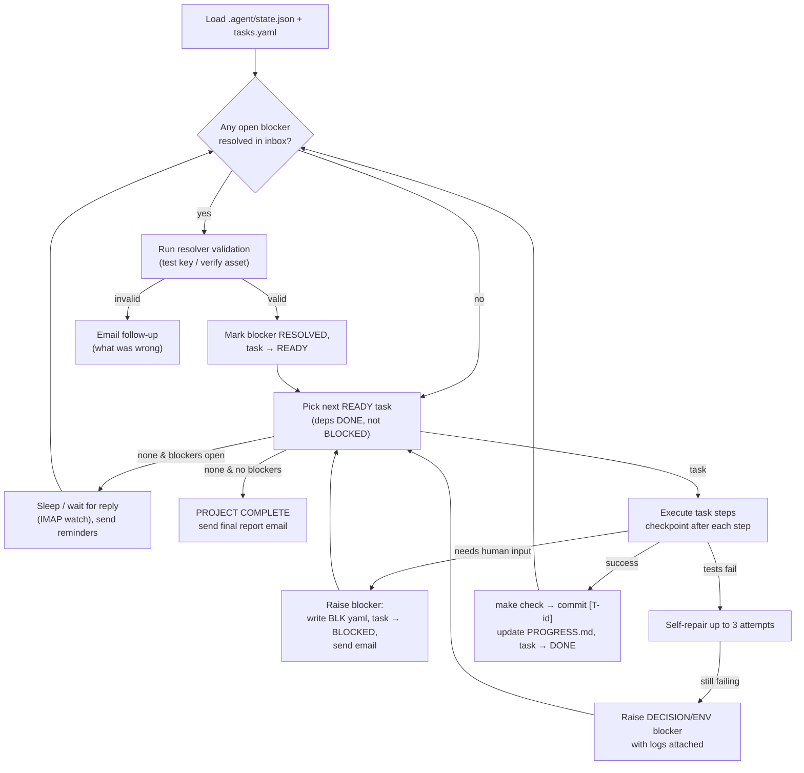
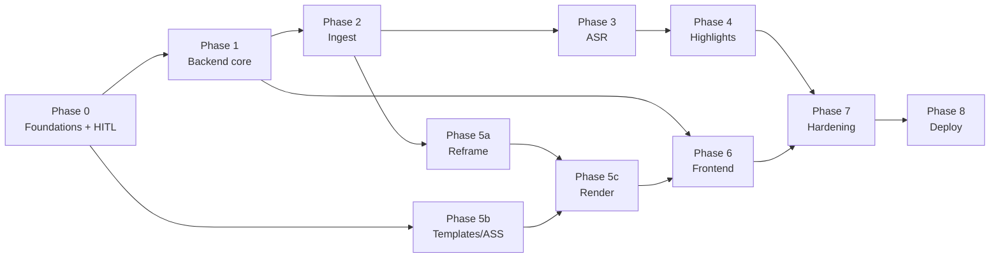

# CLIPPER — AI Video Clipping & Captioning Platform
### Principal Architecture Blueprint & Autonomous Execution Roadmap (v1.0)

> [!IMPORTANT]
> **Audience:** the autonomous executor models (and you, the owner). Every section is written to be *directly actionable*. Executors MUST read §0 (Ground Rules) and §9 (Autonomous Loop + HITL Protocol) before writing any code.

---

## Table of Contents
0. Ground Rules for Executors
1. Product Scope & Non-Goals
2. System Architecture
3. Tech Stack (with rationale)
4. Repository & Folder Structure
5. Processing Pipeline — Deep Dive (Ingest → Transcribe → Detect → Reframe → Caption → Render)
6. Caption Template System (spec you will supply assets against)
7. Data Model, API & Real-time Progress
8. Frontend UX Spec
9. Autonomous Build Loop & Human-in-the-Loop (Email) Protocol
10. Phased Task Graph (machine-readable)
11. Testing & Quality Gates
12. Deployment Path (Local → Web)
13. Day-0 Human Checklist
14. Risks & Mitigations

---

## 0. Ground Rules for Executors

1. **Local-first, cloud-ready.** Everything must run with `make dev` on a single Windows/Linux/macOS PC with *no paid services required* (an optional cloud LLM may be enabled via key). Cloud deploy is a configuration change, never a rewrite.
2. **Every task is idempotent and checkpointed.** A task may be killed at any moment; re-running it must converge to the same result (see §9.4).
3. **One task = one branch of work = one commit** with message `[T-<id>] <title>`. Tests for that task must pass before commit.
4. **Never hard-code secrets.** All config via `pydantic-settings` reading `.env`. Missing secret ⇒ raise `BlockerRequired` (see §9) — never invent placeholder keys, never mock around a missing key in production code.
5. **Never block the whole project on one blocker.** Mark the task `BLOCKED`, email the owner, and continue with any task whose dependencies are satisfied (`pause_mode: branch`, default).
6. **Definition of Done** for every task = acceptance criteria in §10 met + `make check` (lint, type-check, tests) green + `PROGRESS.md` updated.
7. **FFmpeg is the rendering engine; MoviePy is optional glue only.** (MoviePy’s TextClip cannot shape Devanagari/Bengali correctly — see §3.)

---

## 1. Product Scope & Non-Goals

### In scope (v1)
| # | Capability | Detail |
|---|---|---|
| F1 | Link ingest | YouTube (videos, Shorts, live VODs), Instagram (Reels/posts), Facebook (videos/Reels). Also local file upload. |
| F2 | Full transcription | Word-level timestamps; languages: English, Hindi, Hinglish (code-switched), Bengali. Auto-detect + manual override. |
| F3 | Highlight detection | Ranks moments by virality/impact; outputs **up to 12** clips, **only those above a quality threshold** (could be 3, could be 12). |
| F4 | Auto-reframe | 16:9 → 9:16 (also 1:1, 4:5) with face/speaker tracking; fallback to blurred-background fit. |
| F5 | Styled captions | Pick from template gallery (fonts, colours, animations, positions); live preview; burn-in via libass. |
| F6 | Review & edit | Trim clip in/out, edit transcript words, swap template, re-render one clip. |
| F7 | Export | MP4 (H.264/AAC), SRT/ASS sidecar, title + hashtags suggestions per clip. ZIP download of all. |
| F8 | Job dashboard | History, progress bars (SSE), retry failed stage. |

### Non-goals (v1)
Multi-user billing, direct auto-posting to social platforms, B-roll generation, voice dubbing. (Designed so they can be added in v2.)

> [!WARNING]
> **Legal note:** downloading content from YouTube/Instagram/Facebook may violate those platforms’ Terms of Service unless you own the content or have permission. Build for personal use on content you have rights to; the public deployment (§12) should require an "I have rights to this content" checkbox.

---

## 2. System Architecture



### Pipeline state machine (per Job)



Each stage writes its artefact to disk (`data/jobs/<job_id>/<stage>/…`) and records a **stage checkpoint** in DB; retry resumes from the first stage without a valid artefact. An "auto mode" toggle skips `AWAITING_REVIEW` using the user’s default template.

---

## 3. Tech Stack (with rationale)

| Layer | Choice | Why / Notes |
|---|---|---|
| Language | Python 3.11 (backend), TypeScript (frontend) | ML ecosystem; type safety on UI. |
| Env mgmt | `uv` + `pyproject.toml`; `pnpm` for UI | Fast, reproducible, lockfiles. |
| API | FastAPI + Uvicorn | Async, OpenAPI auto-docs, SSE support. |
| DB/ORM | SQLModel (SQLAlchemy 2) + Alembic | SQLite locally → Postgres by URL change. |
| Queue | **Huey** (SQLite storage locally, Redis in prod) | Zero-infra locally; same code in prod. |
| Downloader | **yt-dlp** (pinned, auto-update command) + FFmpeg | Supports YT/IG/FB. IG/FB often need browser cookies (`cookies.txt`) → HITL blocker type `CREDENTIAL`. |
| ASR | **faster-whisper** `large-v3` (GPU, float16) / `medium` int8 (CPU fallback) | 4× faster than openai-whisper, native `word_timestamps=True`. |
| Alignment | **WhisperX** forced alignment (wav2vec2) for `en`, `hi`; Bengali uses faster-whisper word timestamps + optional `bn` wav2vec2 model if configured | Tighter word timing for karaoke captions. |
| Indic boosts | Optional fine-tuned checkpoints (e.g. AI4Bharat IndicWhisper family) selectable per language in `config/asr.yaml` | Better Hindi/Bengali WER; pluggable. |
| Hinglish | Whisper decode with `language="hi"` + **script normaliser**: output in Devanagari *or* Romanised (user option) via IndicXlit or LLM transliteration | Hinglish audiences usually prefer Roman script captions. |
| VAD / Audio | Silero VAD (bundled in faster-whisper), `librosa` for RMS/energy | Silence-snapping clip boundaries; energy features. |
| Scene detection | PySceneDetect (`ContentDetector`) | Avoid cutting mid-shot; scene-change features. |
| Highlight LLM | Provider interface: **Gemini API** (default if key) / **Ollama** local (`qwen2.5:7b-instruct` or `llama3.1:8b`) | Works offline; structured JSON output. |
| Face tracking | MediaPipe Face Detection + EMA/Kalman smoothing | Lightweight, CPU-viable. |
| Captions | **pysubs2 → ASS** rendered by **FFmpeg libass (with HarfBuzz + FriBidi)** | Only robust path for Devanagari/Bengali shaping + rich animation (`\k`, `\t`, `\fad`, `\move`, `\fscx`). |
| Fonts | Noto Sans / Noto Sans Devanagari / Noto Sans Bengali, Hind Siliguri, Mukta, Poppins, Montserrat, Bebas Neue (+ your custom fonts) | All templates must declare per-script fallback fonts. |
| Frontend | React 18 + Vite + TailwindCSS + shadcn/ui + TanStack Query + Zustand | Clean, fast; served as static files by FastAPI in prod. |
| Player/Preview | HTML5 video + CSS caption overlay driven by same template JSON; final via server render | Instant template preview without re-encode. |
| Storage | `StorageBackend` interface: `LocalFS` / `S3Compatible` (Cloudflare R2) | Swap by env var. |
| Notifications | `smtplib` (Gmail App Password) **or** Gmail API; inbound via `imaplib` IDLE/poll | Powers HITL protocol (§9). |
| Packaging | Docker + docker-compose (api, worker, redis, postgres, caddy) | One-command deploy. |
| Quality | ruff, mypy (strict on `core/`), pytest, Playwright (E2E), eslint, tsc | Gates in §11. |

> [!NOTE]
> **FFmpeg build requirement:** must be compiled with `--enable-libass --enable-libharfbuzz --enable-libfribidi --enable-libfreetype --enable-libx264`. On Windows use the gyan.dev "full" build; on Linux use a static build from johnvansickle or BtbN. Task `T-0.4` verifies this with a Bengali shaping test render.

---

## 4. Repository & Folder Structure

```
clipper/
├── AGENTS.md                    # Executor operating manual (copy of §0 + §9)
├── PROGRESS.md                  # Human-readable progress log (auto-updated)
├── Makefile                     # dev, check, test, worker, ui, render-sample, loop
├── pyproject.toml / uv.lock
├── .env.example                 # every variable documented, no real values
├── docker-compose.yml
├── docker/
│   ├── api.Dockerfile
│   ├── worker.Dockerfile        # CUDA variant + CPU variant
│   └── Caddyfile
├── .agent/                      # ── Autonomous loop state (§9) ──
│   ├── tasks.yaml               # task graph (from §10), status per task
│   ├── state.json               # current task, step checkpoint, last SHA
│   ├── blockers/                # BLK-XXXX.yaml (open/resolved)
│   ├── inbox/                   # attachments received from owner replies
│   └── logs/                    # loop run logs
├── hitl/                        # ── Human-in-the-loop service ──
│   ├── __init__.py
│   ├── models.py                # Blocker, BlockerType, Resolution
│   ├── raise_blocker.py         # API used by executor/code: raise + persist + notify
│   ├── notifier.py              # SMTP / Gmail API sender, templated emails
│   ├── inbox_watcher.py         # IMAP poller: parse replies, attachments
│   ├── resolvers.py             # per-type validation (test key, check asset, etc.)
│   ├── templates/               # blocker_email.html.j2, reminder.html.j2, digest.html.j2
│   └── cli.py                   # `python -m hitl status|resolve BLK-0003|watch`
├── backend/
│   ├── app/
│   │   ├── main.py              # FastAPI app factory, static UI mount
│   │   ├── config.py            # pydantic-settings
│   │   ├── db.py                # engine/session
│   │   ├── models/              # job.py, clip.py, transcript.py, template.py
│   │   ├── schemas/             # pydantic I/O schemas
│   │   ├── api/
│   │   │   ├── jobs.py          # POST /jobs, GET /jobs/{id}, retry, delete
│   │   │   ├── clips.py         # PATCH trim/text, POST render
│   │   │   ├── templates.py     # list/preview templates
│   │   │   ├── events.py        # SSE progress stream
│   │   │   └── files.py         # signed/local file serving
│   │   └── services/storage.py  # LocalFS / S3 backends
│   ├── pipeline/
│   │   ├── orchestrator.py      # stage runner, checkpoints, retries
│   │   ├── tasks.py             # Huey task definitions
│   │   ├── ingest/
│   │   │   ├── downloader.py    # yt-dlp wrapper, platform detection, cookies
│   │   │   └── normalize.py     # ffmpeg → mezzanine mp4 + 16k mono wav
│   │   ├── asr/
│   │   │   ├── engine.py        # ASREngine protocol
│   │   │   ├── faster_whisper_engine.py
│   │   │   ├── aligner.py       # WhisperX alignment
│   │   │   ├── lang.py          # detection, Hinglish heuristics
│   │   │   └── script.py        # transliteration / normalisation
│   │   ├── highlights/
│   │   │   ├── segmenter.py     # sentence/thought segmentation
│   │   │   ├── features.py      # audio energy, speech rate, scenes, laughter
│   │   │   ├── llm_scorer.py    # LLM prompt + JSON schema
│   │   │   ├── providers/       # gemini.py, ollama.py, base.py
│   │   │   ├── ranker.py        # fusion score, NMS, threshold, top-K
│   │   │   └── boundaries.py    # snap to silence/sentence/scene
│   │   ├── reframe/
│   │   │   ├── face_track.py    # MediaPipe + smoothing
│   │   │   ├── crop_path.py     # per-frame crop window → ffmpeg sendcmd / expr
│   │   │   └── layouts.py       # fill, fit-blur, split-screen
│   │   ├── captions/
│   │   │   ├── template_loader.py   # JSON schema validation
│   │   │   ├── chunker.py           # words → caption lines (max chars, per script)
│   │   │   ├── ass_builder.py       # template + words → .ass
│   │   │   └── animations.py        # karaoke, pop, bounce, typewriter, highlight-word
│   │   ├── render/
│   │   │   ├── ffmpeg_cmd.py        # command builder (pure, unit-testable)
│   │   │   └── renderer.py          # execute, progress parsing
│   │   └── meta/
│   │       └── titles.py            # LLM title/hashtag suggestions
│   └── tests/ (unit, integration, golden/)
├── frontend/
│   ├── src/
│   │   ├── pages/  Home.tsx, Job.tsx, ClipEditor.tsx, Templates.tsx, Settings.tsx
│   │   ├── components/ UrlInput, ProgressTimeline, ClipCard, TemplatePicker,
│   │   │               CaptionPreview, TranscriptEditor, TrimBar
│   │   ├── lib/ api.ts, sse.ts, captionPreview.ts (template JSON → CSS)
│   │   └── store/
│   └── tests/e2e/
├── assets/
│   ├── fonts/                   # .ttf/.otf (licensed!)
│   ├── templates/               # <template_id>/template.json + preview.png
│   └── samples/                 # short CC-licensed test videos per language
├── config/
│   ├── asr.yaml  highlights.yaml  render.yaml
└── data/                        # gitignored: jobs/<job_id>/{source,audio,asr,highlights,clips,renders}
```

---

## 5. Processing Pipeline — Deep Dive

### 5.1 Ingest (`pipeline/ingest`)
1. **Platform detection** by regex on URL → `youtube | instagram | facebook | direct | unknown`.
2. **Metadata probe:** `yt-dlp -J` → title, duration, uploader, thumbnails, chapters (YouTube chapters + "most replayed" heatmap if present — store as a **free virality signal**).
3. **Download:** format `bv*[height<=1080]+ba/b`, merge to MP4; `--cookies` from `secrets/cookies/<platform>.txt` if present.
   - If IG/FB returns login-required/403 ⇒ raise `BlockerRequired(type=CREDENTIAL, key="COOKIES_INSTAGRAM")`.
4. **Normalise:** mezzanine `source.mp4` (CFR 30fps, H.264) and `audio.wav` (16 kHz mono PCM) for ASR.
5. **Guards:** max duration (default 3 h, configurable), disk-space check, yt-dlp version check (`make update-ytdlp`).

### 5.2 Transcription (`pipeline/asr`)
1. **Language detection** on 3 windows (start/middle/end, 30 s each) → majority vote. Hinglish heuristic: detected `hi` **and** ≥ 25 % of tokens are Latin-script or English-dictionary words in a Roman-script pass → label `hinglish`.
2. **Decode:** faster-whisper `large-v3`, `word_timestamps=True`, `vad_filter=True`, `beam_size=5`, `condition_on_previous_text=False` (reduces hallucination loops), chunked for long videos.
3. **Alignment:** WhisperX align for `en`/`hi`; if alignment model unavailable for language, keep Whisper word timings.
4. **Script normalisation** (`script.py`):
   - `hindi` → Devanagari (default) or Roman (option).
   - `hinglish` → Roman by default (IndicXlit / LLM transliteration of Devanagari tokens; English tokens untouched).
   - `bengali` → Bengali script; Unicode NFC normalisation.
5. **Output** `asr/transcript.json`:
```json
{
  "language": "hinglish", "script": "latn", "duration": 1834.2,
  "segments": [{"id": 0, "start": 12.04, "end": 16.9, "text": "...",
     "words": [{"w": "Dosto", "s": 12.04, "e": 12.41, "p": 0.93}]}]
}
```
6. **Quality signal:** mean word probability per segment, used later to down-rank low-confidence regions.

### 5.3 Highlight Detection (`pipeline/highlights`) — the core IP

**Step A — Segmentation:** group words into *thought units* (sentences ending in punctuation or pauses > 0.6 s), then build candidate windows by sliding over thought units to produce spans of **20–60 s** (configurable `min_len`, `max_len`, `target_len`).

**Step B — Signal features** (per candidate, normalised 0–1):
| Feature | Source | Intuition |
|---|---|---|
| `energy` | RMS loudness z-score | Excitement, emphasis |
| `speech_rate` | words/sec vs. video median | Passion/urgency |
| `laughter_applause` | YAMNet (optional) or energy-spike heuristic | Audience reaction |
| `scene_dynamics` | PySceneDetect cuts/min | Visual energy |
| `heatmap` | YouTube "most replayed" | Real audience signal (when available) |
| `asr_conf` | mean word prob | Avoid garbled clips |
| `face_presence` | MediaPipe sample frames | Vertical-friendly |

**Step C — LLM semantic scoring** (batched, map-reduce for long videos):
- Map: transcript split into ~8-minute overlapping chunks; LLM returns candidate moments with exact `start_word_idx`/`end_word_idx`.
- Reduce: global re-rank of top ~30 candidates with full-video summary context.
- Prompt contract (`llm_scorer.py`), JSON-schema enforced:
```text
SYSTEM: You are a short-form video editor who has produced 10,000 viral Reels/Shorts
for Indian and global audiences. Language of transcript: {language}.
Identify self-contained moments that would perform as standalone 20–60s vertical clips.
Score each 0–100 on: hook (first 3s grabs attention), payoff (clear punchline/insight/
emotional peak), standalone (no missing context), emotion, shareability/controversy,
and quotability. Reject moments that start mid-thought or end before the payoff.
Return ONLY JSON matching the schema.
SCHEMA: {"moments":[{"start_word_idx":int,"end_word_idx":int,"hook":int,"payoff":int,
"standalone":int,"emotion":int,"shareability":int,"quotability":int,
"title":str,"reason":str,"hook_line":str,"hashtags":[str]}]}
```

**Step D — Fusion & selection (`ranker.py`):**

$$S = 0.55\,L + 0.10\,E + 0.07\,R + 0.08\,A + 0.05\,D + 0.10\,H + 0.05\,C$$

where L = LLM composite, E = energy, R = speech rate, A = audience reaction, D = scene dynamics, H = heatmap (weight redistributed to L if absent), C = ASR confidence. Weights live in `config/highlights.yaml`.

- **Non-max suppression:** drop candidates overlapping a higher-scored one by > 30 %.
- **Adaptive count:** keep clips with `S ≥ threshold` (default 0.62), cap at `max_clips` (default 12), floor at `min_clips` (default 3 if any candidate ≥ 0.45). This delivers "10–12, or as many good ones as exist."
- **Diversity:** penalise > 2 clips from the same 3-minute region.

**Step E — Boundary snapping (`boundaries.py`):** start = nearest thought-unit start within ±2 s that is also in a VAD silence; end = sentence end + 0.3 s tail; avoid scene cut within 0.4 s of a boundary (shift to cut). Output `highlights/clips.json` with rank, score breakdown, title, hashtags, reason.

### 5.4 Reframe (`pipeline/reframe`)
1. Sample frames at 5 fps over the clip; MediaPipe face detection → boxes.
2. **Subject selection:** largest face × mouth-motion proxy (landmark delta) ≈ active speaker; hysteresis to avoid flicker (switch only if new subject dominates ≥ 1.0 s).
3. **Smoothing:** EMA (α≈0.15) + max pan speed clamp; dead-zone of 5 % width.
4. **Crop path** → FFmpeg `crop` with `sendcmd` keyframes (or piecewise linear `expr`).
5. **Layouts:** `fill` (tracked crop), `fit_blur` (original scaled into blurred, zoomed background — fallback when no faces / multiple faces far apart), `split` (two speakers stacked; v1.1).
6. Output resolution: 1080×1920 (9:16), 1080×1080, 1080×1350.

### 5.5 Caption Building (`pipeline/captions`)
1. **Chunker:** words → caption "pages" by template rules (`max_words_per_line`, `max_lines`, `max_chars` adjusted per script: Devanagari/Bengali ≈ 0.8× Latin char budget), breaking at punctuation/pauses, never splitting conjuncts (operate on words, not characters).
2. **ASS builder:** template JSON → ASS `[V4+ Styles]` + `Dialogue` events; per-word animation via override tags:
   - `karaoke_fill` → `\kf<cs>`
   - `highlight_word` → active word gets `\c&H<accent>&\fscx115\fscy115` via split events
   - `pop` → `\t(0,80,\fscx120\fscy120)\t(80,160,\fscx100\fscy100)`
   - `typewriter` → cumulative reveal events
   - `fade_slide` → `\fad(80,80)\move(...)`
   - `emoji_auto` (v1.1) → LLM-chosen emoji per page
3. **Font fallback:** each template declares `fonts.latn`, `fonts.deva`, `fonts.beng`; builder picks per word script (Unicode-range detection) and emits `\fn` overrides inline for mixed-script lines (crucial for Hinglish/Bengali-English mixes).
4. **Safe areas:** position avoids platform UI (bottom 18 % and right 12 % reserved on 9:16) unless template overrides.

### 5.6 Render (`pipeline/render`)
Single FFmpeg pass per clip:
```bash
ffmpeg -ss {start} -to {end} -i source.mp4 \
  -filter_complex "[0:v]{reframe_filters},scale=1080:1920,ass=clip.ass:fontsdir=assets/fonts[v]" \
  -map "[v]" -map 0:a -c:v libx264 -preset medium -crf 20 -pix_fmt yuv420p \
  -c:a aac -b:a 160k -af loudnorm=I=-14:TP=-1.5:LRA=11 -movflags +faststart out.mp4
```
- Command built by a **pure function** (`ffmpeg_cmd.py`) → unit-tested via golden strings.
- Progress parsed from `-progress pipe:1` → SSE events.
- Hardware encode option (`h264_nvenc`) auto-detected.
- Also writes `clip.srt`, `clip.ass`, `thumb.jpg` (frame at hook), `meta.json` (title, hashtags, score).

---

## 6. Caption Template System

You will supply templates; executors must build the loader/validator so new templates are **drop-in folders**, no code changes.

### 6.1 Template folder
```
assets/templates/bold_pop_yellow/
├── template.json
├── preview.png          # 540×960 sample (auto-generated if missing)
└── fonts/ (optional template-specific fonts)
```

### 6.2 `template.json` schema (v1)
```json
{
  "id": "bold_pop_yellow",
  "name": "Bold Pop – Yellow",
  "version": 1,
  "aspect": ["9:16", "1:1", "4:5"],
  "fonts": { "latn": "Montserrat ExtraBold", "deva": "Mukta ExtraBold", "beng": "Hind Siliguri Bold" },
  "size_px": 78,
  "case": "upper",
  "colors": { "primary": "#FFFFFF", "active": "#FFE600", "outline": "#000000", "shadow": "#00000099", "box": null },
  "outline_px": 6, "shadow_px": 3,
  "box": { "enabled": false, "padding_px": 16, "radius_px": 12 },
  "layout": { "position": "lower_third", "y_percent": 68, "align": "center",
              "max_words_per_line": 3, "max_lines": 2 },
  "animation": { "type": "highlight_word", "in": "pop", "out": "none", "duration_ms": 160 },
  "emphasis": { "keywords_bold": true, "keyword_color": "#00E5FF" },
  "emoji": false
}
```
- Validated via JSON Schema (`template_loader.py`); invalid template ⇒ skipped with a warning + HITL `ASSET` blocker if *zero* valid templates exist.
- Frontend `captionPreview.ts` maps the same JSON to CSS for instant preview; server render is source of truth.

### 6.3 Starter templates (executors create these so the app works before your assets arrive)
`clean_white`, `bold_pop_yellow`, `karaoke_green`, `boxed_black`, `minimal_lowercase`, `neon_glow`. Your templates replace/extend these via the `ASSET` blocker (§9).

---

## 7. Data Model, API & Real-time Progress

### 7.1 Tables
| Table | Key columns |
|---|---|
| `job` | id (ulid), source_url, platform, title, duration, language, status, stage, error, settings_json, created_at |
| `stage_checkpoint` | job_id, stage, status, artefact_path, started_at, finished_at, attempt |
| `transcript` | job_id, language, script, path_json |
| `clip` | id, job_id, rank, start, end, score, score_breakdown_json, title, hashtags, reason, layout, template_id, status |
| `render` | id, clip_id, template_id, aspect, path_mp4, path_srt, path_ass, status, created_at |
| `template` | id, name, version, path, valid, preview_path |

### 7.2 REST API (prefix `/api/v1`)
| Method | Path | Purpose |
|---|---|---|
| POST | `/jobs` | `{url | upload_id, language: auto|en|hi|hinglish|bn, script_pref, aspect, auto_mode, template_id, max_clips}` |
| GET | `/jobs`, `/jobs/{id}` | List / detail incl. clips |
| POST | `/jobs/{id}/retry` | Resume from failed stage |
| DELETE | `/jobs/{id}` | Remove job + files |
| GET | `/jobs/{id}/events` | **SSE**: `{stage, pct, message, eta}` |
| GET | `/jobs/{id}/transcript` | Word-level JSON |
| PATCH | `/clips/{id}` | Trim `{start,end}`, edit words, layout |
| POST | `/clips/{id}/render` | `{template_id, aspect}` |
| POST | `/jobs/{id}/render-all` | Batch render |
| GET | `/jobs/{id}/download.zip` | All renders + sidecars |
| GET | `/templates` | Gallery |
| POST | `/uploads` | Chunked local file upload |
| GET | `/health` | ffmpeg/libass/GPU/model readiness |

---

## 8. Frontend UX Spec

1. **Home:** big URL field (paste → platform icon auto-detected), language dropdown (Auto / English / हिन्दी / Hinglish / বাংলা), aspect toggle, "Auto mode" switch, template mini-picker. Recent jobs list.
2. **Job page:** vertical progress timeline (Download → Transcribe → Find moments → Render) with live % and ETA; when clips are ready → grid of `ClipCard`s ordered by score (thumbnail, score badge, title, duration, "why this clip").
3. **Clip editor:** 9:16 player with live CSS caption overlay; **template carousel** (tap to apply, instant preview); trim bar with waveform; transcript editor (click word → edit text/timing); layout switch (Fill/Fit-Blur); "Render" + "Download".
4. **Templates page:** gallery with previews; shows invalid templates with reasons.
5. **Settings:** model size, device (CPU/GPU), LLM provider, thresholds, default template, cookies status, storage path.
6. Design: dark theme, mobile-responsive (tap-first, as you described), accessible contrast.

---

## 9. Autonomous Build Loop & Human-in-the-Loop (Email) Protocol

### 9.1 Loop overview



### 9.2 Blocker taxonomy
| Type | Examples | How owner resolves | Validation before resume |
|---|---|---|---|
| `SECRET` | `GEMINI_API_KEY`, SMTP app password, R2 keys | Put value in `.env` (or the secure local form), reply **DONE** | Live test call (e.g. list models) |
| `CREDENTIAL` | IG/FB `cookies.txt`, OAuth client JSON | Drop file in `secrets/` or attach to reply | File parses; test download succeeds |
| `ASSET` | Caption templates, fonts, logo | Attach files to reply or drop in `assets/inbox/` | Schema validate; font loads; test render |
| `DECISION` | Ambiguous requirement, trade-off | Reply with option number / free text | Parsed answer recorded in `DECISIONS.md` |
| `ENVIRONMENT` | No GPU/CUDA mismatch, FFmpeg lacks libass, disk full | Install / change, reply **DONE** | `/health` check passes |
| `ACCOUNT` | Domain, hosting account, payment-required action | Perform action, reply DONE + details | Specific probe (DNS resolves, etc.) |

> [!CAUTION]
> **Secrets are never sent by email.** Emails are not a secure channel. For `SECRET` blockers the email instructs you to paste the value into `.env` (or the one-time local form at `http://<host>/hitl/BLK-XXXX?token=…`, served only on localhost/VPN) and reply **DONE**. If a reply body contains something that looks like a key (regex for common key formats), the watcher refuses to use it, redacts the stored copy, and emails you a warning to rotate it.

### 9.3 Blocker record (`.agent/blockers/BLK-0007.yaml`)
```yaml
id: BLK-0007
type: SECRET
status: OPEN            # OPEN → AWAITING_VALIDATION → RESOLVED | REJECTED
task_id: T-3.4
step: 2                 # exact checkpoint to resume at
title: "Gemini API key needed for highlight scoring"
needed:
  - key: GEMINI_API_KEY
    where: ".env"
    how_to_get: "https://aistudio.google.com/app/apikey → Create API key"
why: "LLM semantic scoring (pipeline/highlights/llm_scorer.py). Without it the system falls back to Ollama (slower, needs ~8GB RAM)."
alternatives:
  - "Reply 'USE OLLAMA' to proceed offline instead."
unblocked_meanwhile: [T-4.1, T-4.2, T-6.1]   # work continuing in parallel
created_at: 2026-11-17T20:31:00Z
reminders_sent: 0
correlation_token: "CLP-7f3a9c"
```

### 9.4 Checkpoint & exact-resume semantics
- `state.json`:
```json
{"current_task":"T-3.4","step":2,"last_commit":"a1b2c3d","attempt":1,
 "blocked_tasks":{"T-3.4":"BLK-0007"},"updated_at":"..."}
```
- Each task in `tasks.yaml` is a list of **numbered steps**; after each step the loop writes `state.json` and makes a WIP commit on a local branch `wip/T-3.4` (squashed on task completion). Resume = checkout `wip/T-x`, read `step`, continue from `step`.
- Code paths needing human input call `hitl.raise_blocker(...)`, which raises `BlockerRequired`; the loop catches it, persists, notifies, and moves on.

### 9.5 Email design
- **Outbound** (`notifier.py`): Gmail SMTP with App Password (simplest) or Gmail API (OAuth). Subject: `[CLIPPER][BLK-0007][ACTION NEEDED] Gemini API key needed (task T-3.4)`.
- **Body** (HTML + plaintext): what is needed, why, exact steps to obtain, where to put it, how to reply, alternatives, what work continues meanwhile, progress % of project.
- **Inbound** (`inbox_watcher.py`): IMAP poll every 2 min (IDLE where supported), filter `From == OWNER_EMAIL` **and** subject/body contains correlation token; SPF/DKIM `Authentication-Results: pass` required. Parse first non-quoted lines for commands: `DONE`, `USE OLLAMA`, `OPTION 2`, `SKIP`, free text; save attachments to `.agent/inbox/BLK-0007/`.
- **Reminders:** 24 h and 72 h; after 7 days the blocker is flagged in the daily digest only.
- **Digest:** optional daily email — tasks done, in progress, open blockers, test status.
- **Final report:** on completion — how to run, URLs, known limitations.

### 9.6 Bootstrap paradox (important)
The email channel itself needs credentials. Therefore **Task T-0.2 is the very first blocker and is resolved interactively at setup time** (see §13): `NOTIFY_SMTP_USER`, `NOTIFY_SMTP_APP_PASSWORD`, `OWNER_EMAIL`, IMAP enabled. Until configured, blockers fall back to `PROGRESS.md` + console + a `BLOCKERS.md` file.

### 9.7 Loop runner
`make loop` → `python -m hitl.loop` provides the scheduler shell (task picking, state, blockers, email) and invokes the executor model per task with: task spec, relevant files, `AGENTS.md`, last failure logs. It is executor-agnostic, so any coding agent can be plugged in.

---

## 10. Phased Task Graph (copy to `.agent/tasks.yaml`)

Legend: **deps** = must be DONE first; **HITL** = expected blocker.

### Phase 0 — Foundations
| ID | Task | Deps | Acceptance criteria | HITL |
|---|---|---|---|---|
| T-0.1 | Repo scaffold per §4, `uv`, `pnpm`, Makefile, ruff/mypy/pytest, pre-commit, `.env.example`, `AGENTS.md` | — | `make check` green on empty skeleton | — |
| T-0.2 | HITL service: models, raise_blocker, notifier, inbox_watcher, CLI, loop runner | T-0.1 | Test email sent & reply "DONE" to a test blocker resolves it end-to-end | `SECRET`: SMTP/IMAP creds, OWNER_EMAIL |
| T-0.3 | Config system (pydantic-settings, YAML configs) | T-0.1 | Missing required secret raises `BlockerRequired` | — |
| T-0.4 | Toolchain verification: FFmpeg with libass/harfbuzz, GPU/CUDA detection, `/health` | T-0.1 | Renders a test ASS with Hindi + Bengali text; snapshot visually correct | `ENVIRONMENT` if FFmpeg lacks libass |
| T-0.5 | Sample media: fetch 4 short CC-licensed clips (en/hi/hinglish/bn) into `assets/samples` | T-0.1 | Files present + checksums | `ASSET` if none found |

### Phase 1 — Backend core
| ID | Task | Deps | Acceptance | HITL |
|---|---|---|---|---|
| T-1.1 | DB models + Alembic migrations | T-0.3 | Migrate up/down tests | — |
| T-1.2 | Storage backend (LocalFS; S3 stub) | T-0.3 | Unit tests | — |
| T-1.3 | Huey queue + orchestrator with stage checkpoints & retry-from-stage | T-1.1 | Killing worker mid-stage then retry resumes correctly | — |
| T-1.4 | FastAPI app, jobs/clips/templates endpoints, SSE events | T-1.3 | OpenAPI served; SSE test receives events | — |

### Phase 2 — Ingest
| ID | Task | Deps | Acceptance | HITL |
|---|---|---|---|---|
| T-2.1 | yt-dlp wrapper, platform detection, metadata/heatmap capture | T-1.3 | YouTube sample downloads; metadata stored | — |
| T-2.2 | Instagram/Facebook support with cookies | T-2.1 | Public reel downloads; login-wall raises blocker | `CREDENTIAL`: cookies.txt per platform |
| T-2.3 | Normalise to mezzanine mp4 + 16k wav; local upload path | T-2.1 | ffprobe asserts formats | — |

### Phase 3 — Transcription
| ID | Task | Deps | Acceptance | HITL |
|---|---|---|---|---|
| T-3.1 | faster-whisper engine, model download/cache, CPU/GPU auto | T-2.3 | English sample WER ≤ 12 % vs reference | `DECISION`: model size if <8 GB VRAM |
| T-3.2 | Language detection + Hinglish heuristic | T-3.1 | Correct label on all 4 samples | — |
| T-3.3 | WhisperX alignment + fallback | T-3.1 | Word boundary error median ≤ 120 ms (en/hi) | — |
| T-3.4 | Script normaliser (Devanagari/Roman/Bengali) | T-3.2 | Hinglish sample renders Roman; Bengali NFC | — |

### Phase 4 — Highlight engine
| ID | Task | Deps | Acceptance | HITL |
|---|---|---|---|---|
| T-4.1 | Segmenter + candidate windows | T-3.3 | Windows obey min/max length; no mid-word starts | — |
| T-4.2 | Signal features (energy, rate, scenes, heatmap, conf) | T-4.1 | Feature vectors in [0,1]; unit tests | — |
| T-4.3 | LLM provider interface + Gemini + Ollama providers | T-0.3 | Schema-valid JSON on fixture transcript | `SECRET`: GEMINI_API_KEY *or* `DECISION`: use Ollama |
| T-4.4 | LLM map-reduce scorer + prompt | T-4.3, T-4.1 | Returns ≥ 5 candidates on a 20-min sample | — |
| T-4.5 | Ranker: fusion, NMS, adaptive count, diversity | T-4.2, T-4.4 | 3–12 clips, no >30 % overlap | — |
| T-4.6 | Boundary snapping | T-4.5 | All boundaries in silence ±50 ms | — |
| T-4.7 | Titles/hashtags generation (language-aware) | T-4.4 | Each clip has title + 3–8 hashtags | — |

### Phase 5 — Reframe & captions & render
| ID | Task | Deps | Acceptance | HITL |
|---|---|---|---|---|
| T-5.1 | Face tracking + smoothing + crop path | T-2.3 | Golden crop path on sample within tolerance; no jitter > threshold | — |
| T-5.2 | Layouts: fill, fit_blur | T-5.1 | Visual snapshot tests | — |
| T-5.3 | Template JSON schema + loader + 6 starter templates | T-0.4 | All starters validate; invalid sample rejected | — |
| T-5.4 | Chunker (script-aware) | T-3.4 | No conjunct splits; respects limits | — |
| T-5.5 | ASS builder + animations (karaoke, highlight_word, pop, typewriter, fade_slide) + mixed-script font fallback | T-5.3, T-5.4 | Golden .ass files; rendered frames match snapshots | — |
| T-5.6 | FFmpeg command builder + renderer + progress + NVENC detect | T-5.2, T-5.5 | 60 s clip renders < 1.5× realtime on CPU; loudness −14 LUFS ±1 | — |
| T-5.7 | Owner caption templates import | T-5.3 | Owner templates validate & render | `ASSET`: your templates + fonts |

### Phase 6 — Frontend
| ID | Task | Deps | Acceptance | HITL |
|---|---|---|---|---|
| T-6.1 | Vite/React/Tailwind/shadcn scaffold, API client, routing | T-1.4 | Builds; served by FastAPI | — |
| T-6.2 | Home + job creation + progress timeline (SSE) | T-6.1 | E2E: paste URL → see live stages | — |
| T-6.3 | Clip grid + clip cards | T-6.2 | Shows score, title, reason | — |
| T-6.4 | Clip editor: player, CSS caption preview, template carousel, trim bar, transcript editor | T-6.3, T-5.3 | Template switch preview < 100 ms; edits persist | — |
| T-6.5 | Render/download, ZIP, Templates & Settings pages | T-6.4, T-5.6 | E2E full flow passes | — |

### Phase 7 — Hardening & integration
| ID | Task | Deps | Acceptance | HITL |
|---|---|---|---|---|
| T-7.1 | End-to-end golden test per language (4 samples) | T-6.5, T-4.7 | All pass in CI | — |
| T-7.2 | Error handling, retries, cleanup policy, disk quotas | T-7.1 | Chaos tests (kill worker, net loss) recover | — |
| T-7.3 | Performance tuning (batching, model reuse, parallel renders) | T-7.1 | 30-min video → clips in < 15 min on GPU | — |
| T-7.4 | Docs: README, user guide, template authoring guide | T-7.1 | Fresh-machine setup succeeds from README | — |

### Phase 8 — Deployment (web)
| ID | Task | Deps | Acceptance | HITL |
|---|---|---|---|---|
| T-8.1 | Dockerfiles (CPU & CUDA), compose, Caddy TLS | T-7.2 | `docker compose up` full flow works | — |
| T-8.2 | Postgres + Redis + R2 storage switch | T-8.1 | Same tests pass with prod profile | `SECRET`: R2 keys |
| T-8.3 | Auth (single-owner login, then optional multi-user), rate limits, rights checkbox | T-8.1 | Unauthed requests rejected | `DECISION`: auth method |
| T-8.4 | Deploy to host (GPU VM e.g. RunPod/Lambda, or CPU VPS + Modal GPU for ASR) | T-8.2, T-8.3 | Public HTTPS URL works | `ACCOUNT`: hosting, domain, DNS |



---

## 11. Testing & Quality Gates
- **Unit:** pure functions (ffmpeg_cmd, chunker, ass_builder, ranker, boundaries) — ≥ 85 % coverage on `pipeline/`.
- **Golden tests:** fixed transcripts → expected `.ass`, crop paths, clip sets (tolerance-based).
- **Visual snapshots:** extract frames at fixed timestamps from renders; compare with SSIM ≥ 0.97.
- **Language tests:** per-language WER/CER on samples; Bengali/Devanagari shaping snapshot.
- **E2E:** Playwright — paste URL (local sample served over HTTP) → clips → template → render → download.
- **Gate:** `make check` = ruff + mypy + pytest + eslint + tsc + (nightly) Playwright.

---

## 12. Deployment Path (Local → Web)
| Stage | Setup |
|---|---|
| Local dev | `make dev` → API :8000, UI :5173, Huey worker (SQLite), files in `./data` |
| Local "app" | `make serve` → single process serving built UI; optional desktop shortcut |
| Self-hosted web | docker compose on a GPU VM; Caddy auto-TLS; Postgres/Redis containers |
| Scaled | API on cheap VPS; GPU workers on demand (Modal/RunPod serverless) pulling from Redis; R2 storage + signed URLs |

---

## 13. Day-0 Human Checklist (do these before starting the loop)
1. **Email channel (required for HITL):** a Gmail account with 2-Step Verification → create an *App Password*; enable IMAP. Provide `OWNER_EMAIL`, `NOTIFY_SMTP_USER`, `NOTIFY_SMTP_APP_PASSWORD` in `.env`.
2. **Hardware facts:** GPU model/VRAM (or "CPU only"), RAM, free disk (≥ 50 GB recommended).
3. **LLM choice:** Gemini API key (recommended for quality) *or* accept local Ollama.
4. **Caption templates:** can arrive later via `ASSET` blocker — send `template.json` per §6.2 (or screenshots/descriptions; executors will convert) + font files you have licence for.
5. **IG/FB cookies:** export via a "Get cookies.txt" browser extension when prompted.

---

## 14. Risks & Mitigations
| Risk | Mitigation |
|---|---|
| Platform changes break downloads | Pin + `make update-ytdlp`; integration test nightly; clear error → blocker |
| Hinglish/Bengali ASR accuracy | Pluggable fine-tuned Indic checkpoints; transcript editor; confidence down-ranking |
| Indic text shaping glitches | libass + HarfBuzz verified at T-0.4; Noto fallbacks; shaping snapshot tests |
| LLM picks weak clips | Hybrid fusion with signals; threshold-based adaptive count; user feedback (thumbs) stored for future weight tuning |
| Long videos (2–3 h) slow/expensive | Chunked ASR, map-reduce LLM, GPU worker, caching of ASR per URL hash |
| Autonomous loop stalls | Branch-level blocking, self-repair limit (3), daily digest, reminders |
| Secrets leakage | Never via email; `.env` gitignored; secret regex scanner in pre-commit |
| ToS / copyright | Rights checkbox, personal-use default, no public sharing of downloaded sources |
