# CLIPPER — Local-First AI Video Clipping & Multi-Language Captioning Studio

**CLIPPER** is a local-first, cloud-ready AI Video Clipping, Smart Reframing, Multi-Script Dynamic Captioning, and Multi-Platform Publish-Pack Studio supporting **YouTube**, **Instagram**, **Facebook**, **Google Drive**, and **local video uploads** across **English (`en`)**, **Hindi (`hi`, हिन्दी)**, **Hinglish (`hinglish`)**, and **Bengali / Bangla (`bn`, বাংলা)**.

---

## 1. Quick Start

```bash
# 1. Bootstrap Python (.venv) + Frontend dependencies & verify system tools
make setup

# 2. Run all verification gates (ruff, mypy, secret-scan, pytest, frontend build & vitest)
make check

# 3. Launch API + Huey worker + React Studio & Admin UI
make dev

# 4. Inspect task graph & Human-in-the-Loop (HITL) blockers
.venv/bin/python -m hitl.cli status
```

---

## 2. End-to-End Architecture

```mermaid
flowchart LR
    A["Ingest (yt-dlp / Upload / Drive)"] --> B["Prepare (16kHz WAV + 360p Proxy + Loudness)"]
    B --> C["ASR (faster-whisper + WhisperX Alignment + Script Tagging)"]
    C --> D["Analyze (Scenes + Audio Signals + Faces + LLM Topics)"]
    D --> E["Highlight Engine v2 (Map-Reduce LLM + Signal Fusion + NMS)"]
    E --> F["Smart Reframe (1-Euro Filter + Single/2-Up/PiP/Blur Layouts)"]
    F --> G["Caption & Render (pysubs2 .ASS + FFmpeg libass + -16 LUFS)"]
    G --> H["Publish Pack & ZIP Bundle (Shorts / Reels / FB / TikTok)"]
```



### Core Subsystems
1. **Multi-Source Ingest & Media Prep (`backend/pipeline/ingest/`)**:
   - `yt-dlp` downloader for YouTube, Instagram, and Facebook with Netscape `cookies.txt` lifecycle and automatic HITL `CREDENTIAL` blocker generation (`COOKIES_REQUIRED`).
   - Chunked resumable local upload (`/api/v1/uploads*`) and Google Drive source picker (`/api/v1/drive/pick`).
   - FFmpeg media preparation producing 16 kHz mono WAV, 360p H.264 proxy video, 100 Hz waveform peaks JSON, and EBU R128 loudness stats.
2. **Multi-Language ASR & Forced Alignment (`backend/pipeline/asr/`)**:
   - `faster-whisper` transcription with hardware auto-selection (`cuda/float16` -> `cpu/int8`) and Silero VAD gating.
   - `WhisperX` word-level phoneme/character alignment (`+-40ms` accuracy) with Indic wav2vec2 models for `en`, `hi`, and `bn` + deterministic fallback aligner.
   - Code-switch detector (`en`, `hi`, `hinglish`, `bn`), per-word script tagging (`latn`, `deva`, `beng`), Unicode NFC normalization, and opt-in Devanagari-to-Roman Hinglish transliteration.
3. **Video Intelligence & Highlight Engine v2 (`backend/pipeline/analysis/`, `backend/pipeline/highlights/`)**:
   - Scene-cut detection (`PySceneDetect` + FFmpeg histogram fallback), acoustic signals (RMS energy, speech rate, laughter/applause transients, VAD silence pauses), MediaPipe/motion face tracking + active speaker detection, and LLM topic segmentation.
   - Thought-unit candidate windowing (`20–60s`, never splitting mid-word), Map-Reduce LLM 6-dimension virality scoring (`hook`, `payoff`, `standalone`, `emotion`, `shareability`, `quotability`) with user `clip_brief` modulation, missing-signal weight redistribution, NMS (`IoU <= 0.30`), semantic dedupe (`cosine <= 0.90`), diversity caps, and silence/cut boundary snapping (`clip_plan.json`).
4. **Smart Reframe, Multi-Script ASS Captions & Render (`backend/pipeline/reframe/`, `backend/pipeline/captions/`, `backend/pipeline/render/`)**:
   - 1-Euro smoothed crop path (`fc=1.0`, `beta=0.007`), scene-cut reset, dead-zone hysteresis, and 4 layout modes (`single_subject`, `split_2up`, `pip_screen`, `blurred_bg`).
   - Script-aware caption chunker + `pysubs2` ASS builder supporting 6 animation styles (`karaoke_fill`, `highlight_word`, `pop`, `typewriter`, `fade_slide`, `bounce`), inline `{\fn}` mixed-script font switching, safe-area clamping, and `.ass`/`.srt`/`.vtt` export.
   - Single timeline mapping (`t_out = t_src - removed_duration_before(t_src)`) for filler-word removal and silence trimming + FFmpeg `libass` burn-in (`libx264` / `h264_nvenc`, `-16 LUFS` loudness normalization).
5. **Publish Pack & Google Drive Workspace (`backend/pipeline/publish/`, `drive/`)**:
   - Bilingual platform-tailored titles (3 variants), descriptions, chapters, hashtags, pinned comment CTA, and thumbnail hook text for YouTube Shorts, Instagram Reels, Facebook Reels, and TikTok (`publish_pack.json` + `publish_pack.md`).
   - Read-only incremental Google Drive workspace sync (`CLIPPER/` folder) routing templates (`01_Templates`), fonts (`04_Assets/fonts`), mirrored docs (`00_Docs` with untrusted-data provenance header), reference exemplars (`06_Reference`), and sources (`02_Sources`).
6. **React 19 Studio & Admin Console (`frontend/`)**:
   - **Studio**: URL Paste / Upload / Drive Picker -> Live SSE Stage Progress Timeline -> Ranked Highlight Grid with Score Breakdown -> NLE 9:16 Clip Editor (`J/K/L`, `I/O`, `[`/`]`, Safe-Zone Guides, Word-Level Transcript Editor) -> Publish Pack Drawer & ZIP Export.
   - **Admin Console**: Template Manager & Live Canvas Preview, Assets/Fonts Manager, Scoring Weight Tuner, Versioned Prompt Editor, Drive Sync Dashboard, HITL Blocker Resolution, and Ops/Disk Maintenance.

---

## 3. Documentation & Runbooks

| Document | Description |
|---|---|
| [`docs/USER_GUIDE.md`](docs/USER_GUIDE.md) | Step-by-step Studio & Admin Console user guide |
| [`docs/TEMPLATE_AUTHORING_GUIDE.md`](docs/TEMPLATE_AUTHORING_GUIDE.md) | Authoring & validating multi-script caption/layout template packs |
| [`docs/runbooks/01_ROTATING_COOKIES.md`](docs/runbooks/01_ROTATING_COOKIES.md) | Rotating YouTube / Instagram / Facebook `cookies.txt` |
| [`docs/runbooks/02_ADDING_FONTS.md`](docs/runbooks/02_ADDING_FONTS.md) | Installing & verifying Latin, Devanagari, and Bengali fonts |
| [`docs/runbooks/03_SWITCHING_LLM_PROVIDERS.md`](docs/runbooks/03_SWITCHING_LLM_PROVIDERS.md) | Switching between Ollama, Gemini, OpenAI, and `signals_only` mode |
| [`docs/runbooks/04_CACHE_AND_BACKUP.md`](docs/runbooks/04_CACHE_AND_BACKUP.md) | Disk cache cleanup, retention quotas, and `backup_restore.py` |
| [`docs/runbooks/05_RESOLVING_BLOCKERS_AND_STUCK_JOBS.md`](docs/runbooks/05_RESOLVING_BLOCKERS_AND_STUCK_JOBS.md) | Resolving HITL blockers (`hitl.cli`) and recovering interrupted jobs |
| [`contracts/openapi.yaml`](contracts/openapi.yaml) | Frozen OpenAPI 3.1 REST & SSE contract (`contracts-v1`) |
| [`AGENTS.md`](AGENTS.md) | Autonomous multi-agent operating rules & role ownership matrix |

---

## 4. Docker & Cloud Deployment

```bash
# Local CPU stack (API + Huey Worker + Caddy TLS Proxy)
docker compose up --build -d

# NVIDIA GPU accelerated stack
docker compose --profile gpu up --build -d

# Cloud scaling stack (Postgres + Redis + S3/R2 storage)
docker compose -f docker-compose.yml -f docker/docker-compose.cloud.yml up -d
```
