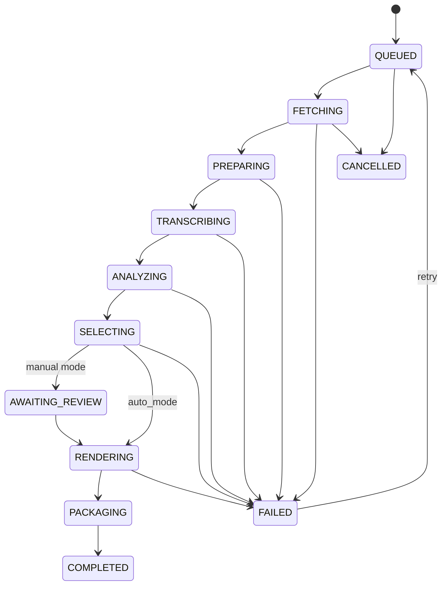

# Job state machine and resume semantics

Per-clip render has its own mini machine: `PENDING -> RUNNING -> DONE | FAILED`; a failed render never fails the whole job.

## Stage definition
`fetch, prepare, transcribe, analyze, select, render, package`. Each stage:
1. computes `input_hash = sha256(upstream artefact hashes + stage config + engine versions + prompt versions)`;
2. if checkpoint DONE with same hash -> skip (cache hit);
3. runs, writes artefacts to a temp dir, fsyncs, atomically renames, then records checkpoint DONE.
Crash at any time leaves either the old valid artefact or none.

## Retry rules
- `RetryableError` (network, 5xx, rate limit): up to 3 attempts, exponential backoff 5/20/60 s.
- `FatalStageError`: FAILED with code; user retry allowed.
- `BlockerRequired`: job `FAILED(code=BLOCKER_REQUIRED)` + blocker created; auto-retry when blocker RESOLVED.
- Retry resumes at the first stage whose checkpoint is not DONE or STALE.

## Staleness propagation
transcript edit -> STALE: `analyze` signals depending on text, `select`; but existing clips keep their plans (owner chose them) and only affected captions/renders are invalidated by `plan_hash`.
Config/prompt/model version change -> affected stage STALE on next run; owner sees "outdated" badge, never silent rerun.

## Progress
Stage weights for overall %: fetch 10, prepare 5, transcribe 30, analyze 15, select 15, render 20, package 5 (configurable). Each stage emits pct 0-100, message, ETA from rolling average.

## Cancellation
Cooperative: worker checks a cancel flag between steps; ffmpeg/yt-dlp subprocesses get SIGTERM then SIGKILL after 10 s; temp dirs cleaned.
