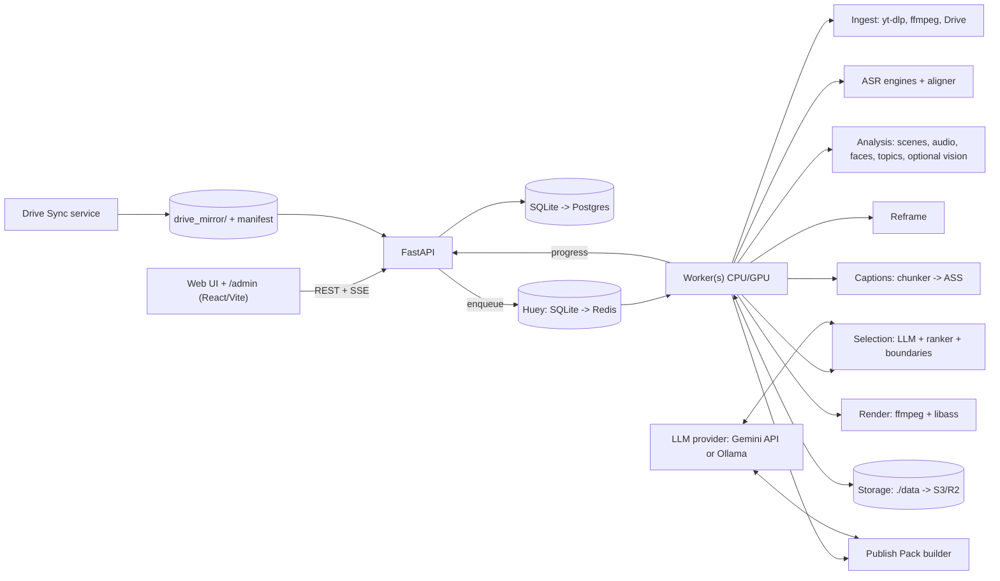

# System Architecture

## Principles
1. **Contract-first**: `contracts/` defines every boundary (REST, JSON artifacts).
2. **Artifacts on disk, state in DB**: every stage writes files under `data/jobs/<id>/<stage>/`; DB stores status, checkpoints, small metadata. A stage is valid iff its recorded `input_hash` equals the current computed hash.
3. **Pure core, impure edges**: command builders, chunker, ranker, ASS builder, boundary snapper are pure and unit-tested; I/O sits in thin adapters.
4. **Pluggable providers** behind protocols: `ASREngine`, `LLMProvider`, `StorageBackend`, `Downloader`, `Diarizer`(stub), `Publisher`(stub), `DriveClient`.
5. **Config over code**: weights, thresholds, profiles, prompts, platform specs live in `config/`, hot-reloadable from admin with audit.
6. **Local-first, cloud-ready**: swapping SQLite/Huey-SQLite/LocalFS for Postgres/Redis/R2 is an env change.
7. **Failure is a feature**: typed errors (`BlockerRequired`, `RetryableError`, `FatalStageError`) map to UI messages and blockers.

## Process model
- `api` (uvicorn), `worker` (huey consumer, 1 GPU-bound worker + N CPU workers), `ui` (vite dev / static in prod), `drive-sync` (optional loop), `hitl-watch` (optional).
- One GPU-heavy stage at a time per GPU (ASR, vision). Renders may run in parallel up to `render.max_parallel`.

## Data flow of one job (artifact contracts)
`source/` -> `media/mezzanine.mp4 + audio.wav` -> `asr/transcript.json` -> `analysis/{video_profile,scenes,signals,faces,topics}.json` -> `highlights/{candidates,scored,clips}.json` -> per clip `clips/<id>/{clip_plan.json, reframe_path.json, captions.ass}` -> `renders/<id>/<render_id>/out.mp4` -> `clips/<id>/publish_pack.json`.

## Cross-cutting
- Logging: structured JSON, job_id + stage in every line, secrets redacted.
- Telemetry: none sent anywhere. Local timings stored per stage for performance tuning.
- Versioning: every artifact records `engine_versions` (ffmpeg, model ids, prompt versions, template versions, config hash).
