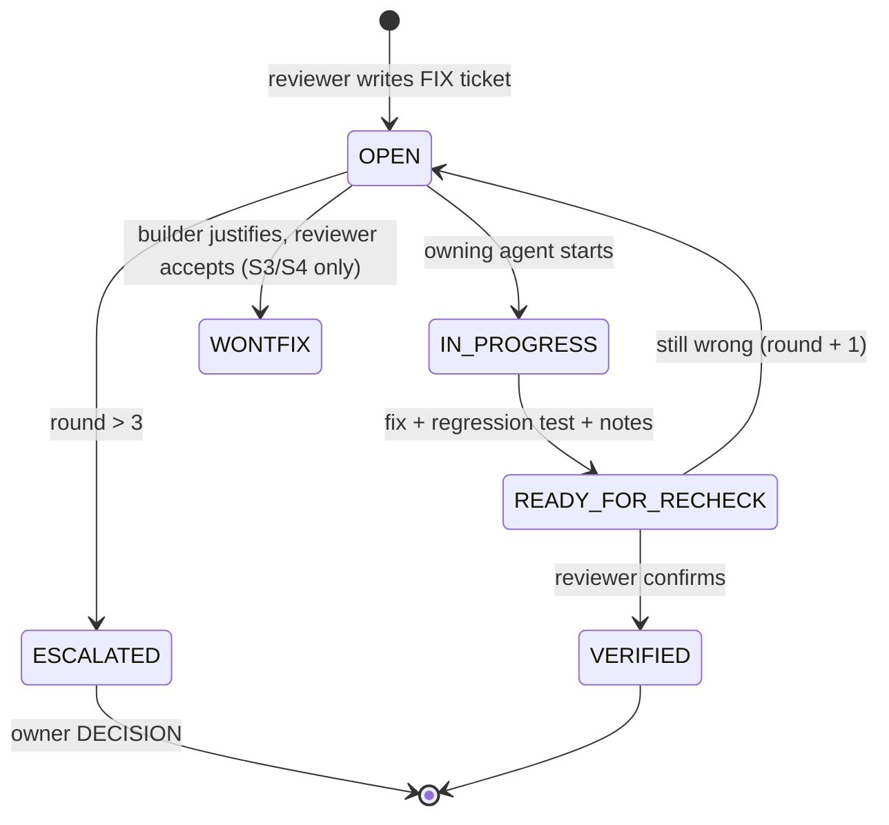

# Review -> Fix -> Verify protocol

## How the "interaction" reaches the builder
1. Reviewer writes `.clipper-state/tickets/FIX-xxxx.yaml` including `dispatch_prompt` (ready-to-paste).
2. Orchestrator lists OPEN tickets per role in its dispatch output (or the owner opens the ticket folder).
3. Start/continue the builder's Agent Manager conversation with the `dispatch_prompt`.
4. Builder fixes, adds regression test, updates ticket `status: READY_FOR_RECHECK` with a `fix_notes` field (what changed, commit sha).
5. Reviewer re-checks, sets VERIFIED. Task status returns to READY_FOR_REVIEW only if the whole task needs another full pass.

## Ticket kinds
`DEFECT, MISSING, CONTRACT_CHANGE, SCOPE_VIOLATION, NIT`. Full YAML in skill `write-fix-ticket`.

## Rules for builders handling tickets
Fix exactly what the ticket says; add the regression test named in `acceptance`; no unrelated refactors; if you disagree, set `WONTFIX` with a one-paragraph reason (reviewer decides); never delete the ticket.

## Rules for reviewers writing tickets
One finding per ticket; evidence required (command output, screenshot, file:line); acceptance must be checkable; severity honest; address the correct role (check ownership map).

## Loop limits and escalation
Max 3 rounds per ticket. Round 3 failure -> `ESCALATED`; orchestrator raises DECISION blocker with: summary, 2-3 options, recommendation. Max 5 open S2 tickets per role before new tasks pause (stop the bleeding).

## Metrics (in `PROGRESS.md`)
Open tickets by severity and role, mean rounds to VERIFIED, first-pass approval rate. A role below 60 % first-pass approval gets its task sizes reduced.

## Phase-end audit
At each phase end the reviewer runs: full `make check`, E2E subset, dependency/licence scan, secret scan, docs link check, contract drift check. Findings become tickets with `task_id: PHASE-n`.
