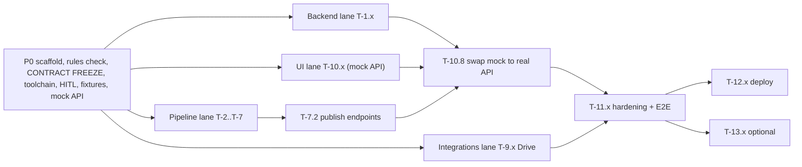

# Task graph (human view; machine truth is `.clipper-state/tasks.yaml`)

## Lanes and order

## Counts per role (65 tasks)
Use `python -c` on tasks.yaml or ask orchestrator for `status`.

## Parallel start (right after T-0.3 contract freeze)
backend: T-1.1 | pipeline: T-2.1, T-6.3 | uiux: T-10.1 | integrations: T-9.1 | reviewer: reviews as tasks land.

## Expected HITL blockers (batch them early)
| When | Blocker | What the owner does |
|---|---|---|
| Day 0 | ENVIRONMENT: FFmpeg with libass | install the full build |
| Day 0 | CREDENTIAL: Drive service account | follow DAY0 checklist |
| T-0.7 | ASSET: sample clips | upload 4+ short clips to Drive `06_Reference` |
| T-3.1b | ASSET: reference transcripts | correct transcripts for 5-10 clips |
| T-5.1 | SECRET or DECISION | Gemini key or choose Ollama |
| T-2.2 | CREDENTIAL: IG/FB cookies | export cookies.txt when prompted |
| T-6.8 | ASSET: your templates and fonts | drop into Drive `02_Templates`, `03_Fonts` |
| T-5.8 | ASSET: labelled "good clips" | list time ranges of 10 videos |
| T-12.x | ACCOUNT/SECRET/DECISION | hosting, R2, auth method |

## Rules
Task ids are stable. A task may be split (T-5.5a/b) but never renumbered. Only the orchestrator edits `tasks.yaml` structure; agents change only their own `status`/`blocker` fields.
